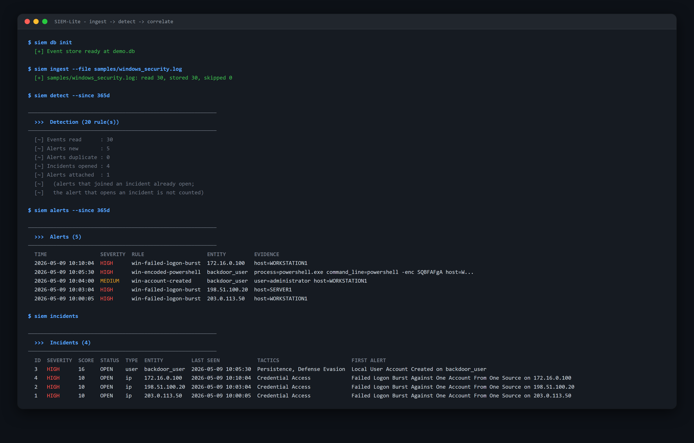
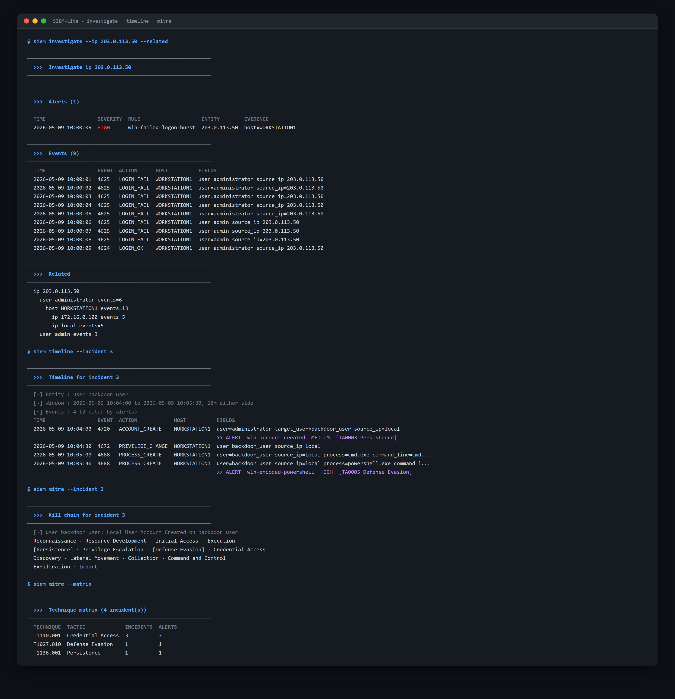
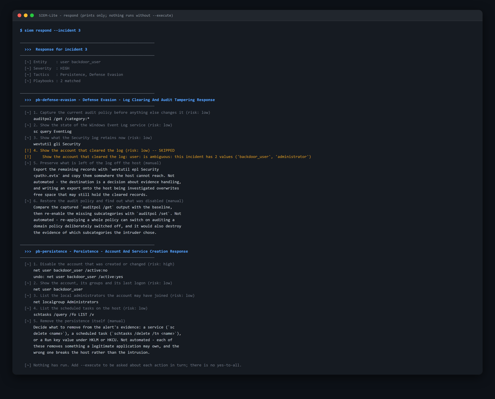

# SIEM-Lite v1.0

A Windows-focused detection and investigation pipeline in a single Python CLI: raw Windows
logs -> ingest -> normalise -> rules -> alerts -> correlation into incidents -> investigate /
timeline / MITRE ATT&CK -> guarded response. It also carries the project's earlier **web
vulnerability scanner** and access-log analyzer, which still work and are documented below.

> **Disclaimer:** This tool is for **educational and authorized testing purposes only**. Do NOT use it against websites you do not own or have explicit written permission to test.

---

## What it does

Twelve `siem` verbs over one SQLite event store:

```
ingest  ->  detect  ->  alerts / incidents  ->  investigate | timeline | mitre | report  ->  respond
                            ^                                                                  |
                         monitor (the same loop on a timer)                   prints only; --execute
                                                                              confirms every action
```

- **20 detection rules**: 18 YAML files in `rules/windows/` plus 2 Python sequence plugins in
  `rules/plugins/`. **Every one carries a MITRE ATT&CK technique and tactic**, across **7
  tactics**. The full table is in [The shipped rules](#the-shipped-rules), and
  `python main.py mitre --matrix` prints the technique counts from your own incidents.
  Read [How much of this has met real logs](#the-shipped-rules) before you read that table as
  field-tested coverage: it is not.
- **3 response playbooks** in `rules/playbooks/`, which **print by default** and never run
  anything without `--execute` and a per-action confirmation.
- **1367 unittest tests**, 0 skips. See [Running the tests](#running-the-tests).

See [Demo](#demo) for screenshots of all three stages on the shipped sample log.

---

## Features

### Advanced Features

| Feature | Description |
|---|---|
| **Real-time Monitoring** | Watchdog-based log file monitoring with event-driven analysis |
| **Alerting System** | Multi-channel alerts (file, JSON, email, desktop notifications) |
| **Persistent Storage** | SQLite database for logs, alerts, correlations, and statistics |
| **CLI Dashboard** | Interactive security metrics dashboard with rich library |
| **Geo-IP Tracking** | IP geolocation and impossible travel detection |
| **MITRE ATT&CK** | Automatic mapping of detections to MITRE techniques |
| **Threat Intelligence** | AbuseIPDB API integration and local blacklist |
| **Anomaly Detection** | Statistical analysis (Z-score) for request spikes |
| **Custom Rules** | Plugin-based rule system for extensible detection |
| **Investigation** | Entity history and a one-hop pivot over stored events and alerts |
| **Guarded Response** | YAML playbooks that print by default and confirm every action individually |
| **Detection Daemon** | `monitor`: ingest, detect and correlate on a timer over a rolling window |

### The legacy web scanner

The project's earlier tool, reached with `--scan` / `--analyze` rather than a `siem` verb. It
is a separate code path with its own database tables and its own rule mechanism; its commands
are under [Legacy web scanner and log analyzer](#legacy-web-scanner-and-log-analyzer).

| Module | Feature | Severity |
|---|---|---|
| **Scanner** | SQL Injection detection (10 payloads, 20+ error signatures) | HIGH |
| **Scanner** | Reflected XSS detection (10 payloads) | HIGH |
| **Scanner** | Security header analysis (7 headers + info disclosure) | HIGH-LOW |
| **Scanner** | TCP port scan (20 common ports) | INFO |
| **Log Analyzer** | Brute-force login detection | HIGH |
| **Log Analyzer** | Suspicious IP frequency analysis | MEDIUM |
| **Log Analyzer** | 404 path scanning / directory enumeration | MEDIUM |
| **Log Analyzer** | Malicious URI detection (SQLi/XSS/traversal in URLs) | HIGH |
| **Log Analyzer** | Web shell access detection | HIGH |
| **Correlation** | Cross-module threat correlation (14 rules with scoring) | CRITICAL |

---

## Quick Start

### Prerequisites

- Python 3.8+
- SQLite 3.24+ (June 2018) for the event store, which uses `ON CONFLICT ... DO NOTHING`. Python 3.8+ builds bundle a newer SQLite; only a build linked against an old system `libsqlite3` fails, with an error at insert time.
- Optional, Windows: `pywin32` for native Event Log access. Without it the `wevtutil` fallback is used.

### Installation

```bash
git clone "https://github.com/sxjalxo/SIEMLite.git"
cd SIEMLite
pip install -r requirements.txt
```

### First run: the whole pipeline on the shipped sample log

`samples/windows_security.log` is a 30-event Windows CSV export: three failed-logon bursts
from three addresses, an account created, privileges assigned to it, and an encoded
PowerShell command. Running it end to end takes five commands and touches nothing on your
host.

```cmd
REM A throwaway store, so db/siem_lite.db is left alone
python main.py --db demo.db db init

python main.py --db demo.db ingest --file samples/windows_security.log
python main.py --db demo.db detect --since 365d
python main.py --db demo.db alerts
python main.py --db demo.db incidents
```

> **Use `--since 365d` here, and do not shorten it.** The sample log is dated 2026-05-09, and
> `detect` defaults to `--since 24h`. A bare `python main.py --db demo.db detect` against this
> file reads **0 events, raises 0 alerts and exits 0** - a clean-looking run that detected
> nothing, and the exit code cannot tell you. Trust the `Events read` number, not the exit
> code. (That is ruling R147; against your own live logs the 24-hour default is the right one.)

What those commands print, verified on a throwaway store (colour stripped, and the widest
columns trimmed to fit this page - the screenshots in [Demo](#demo) show them in full):

```
[+] samples/windows_security.log: read 30, stored 30, skipped 0

>>>  Detection (20 rule(s))
[~] Events read      : 30
[~] Alerts new       : 5
[~] Alerts duplicate : 0
[~] Incidents opened : 4
[~] Alerts attached  : 1

>>>  Alerts (5)
TIME                 SEVERITY  RULE                    ENTITY         EVIDENCE
2026-05-09 10:10:04  HIGH      win-failed-logon-burst  172.16.0.100   host=WORKSTATION1
2026-05-09 10:05:30  HIGH      win-encoded-powershell  backdoor_user  process=powershell.exe ...
2026-05-09 10:04:00  MEDIUM    win-account-created     backdoor_user  user=administrator ...
2026-05-09 10:03:04  HIGH      win-failed-logon-burst  198.51.100.20  host=SERVER1
2026-05-09 10:00:05  HIGH      win-failed-logon-burst  203.0.113.50   host=WORKSTATION1

>>>  Incidents (4)
ID  SEVERITY  SCORE  STATUS  TYPE  ENTITY         TACTICS
3   HIGH      16     OPEN    user  backdoor_user  Persistence, Defense Evasion
4   HIGH      10     OPEN    ip    172.16.0.100   Credential Access
2   HIGH      10     OPEN    ip    198.51.100.20  Credential Access
1   HIGH      10     OPEN    ip    203.0.113.50   Credential Access
```

Then look at incident 3, the one that is more than a brute force:

```cmd
python main.py --db demo.db investigate --ip 203.0.113.50 --related
python main.py --db demo.db timeline --incident 3
python main.py --db demo.db mitre --incident 3
python main.py --db demo.db mitre --matrix
python main.py --db demo.db respond --incident 3
python main.py --db demo.db report --incident 3 --out incident-3.md
```

`respond` **prints and exits**; nothing runs without `--execute`. On this incident it exits
`3`, not `0`, because one action is skipped by placeholder validation - `user:` has two
candidate values in the incident, so the action has no unambiguous target. That is the
designed behaviour, not a failure; see [The safety model](#the-safety-model) and the exit-code
table below.

Delete `demo.db` when you are done with it.

### SIEM Pipeline (Windows)

The `ingest` and `db` commands write to the SQLite event store at `db/siem_lite.db` unless you pass `--db PATH`. That is the same file the legacy `--analyze` flow uses, so use `--db` to try things out without touching your real data.

```cmd
REM Prepare the event store
python main.py db init

REM Ingest the System channel (no elevation required)
python main.py ingest --channel System

REM Ingest the Security channel (requires an Administrator prompt)
python main.py ingest --channel Security --since 24h

REM Ingest an exported log file instead (Apache, SSH or Windows CSV)
python main.py ingest --file samples/windows_security.log

REM Inspect what was stored, grouped by channel and Event ID
python main.py db stats
python main.py --json db stats

REM Use a throwaway store instead of db/siem_lite.db
python main.py --db demo.db db stats

REM DELETES stored events older than 30 days from the store in use
python main.py db purge --older-than 30d
```

Global flags (`--db`, `--json`) go before the command; flags of a command go after it. `python main.py db stats --db demo.db` exits 2 with a usage error.

Ingestion resumes from a per-channel bookmark. Windows returns records oldest first, so when a channel holds more records than `--count` (default 5000) a re-run reads the next batch, not nothing. A re-run stores 0 new events only when `--count` covers the whole window, so leave `--count` at its default if you want that. `--no-resume` re-reads from `--since`; duplicates are discarded either way.

The Security channel requires elevation. Without it, ingestion exits with an instruction rather than an error trace.

#### `ingest` exit codes

| Code | Meaning |
|---|---|
| `0` | Clean: every requested channel (or the file) was read. |
| `1` | Nothing requested could be read: access denied, channel not found (e.g. a typo), or an unreadable file. |
| `2` | Usage error or bad argument value (argparse, e.g. `--since bogus`). |
| `3` | Partial: something asked for was not stored. A channel was denied, e.g. `--channel Security,System` without elevation; or records would not parse — from a channel or a `--file`. |

A channel that does not exist is only a warning while another one was read.

#### Detection, alerts and incidents

Detection rules are YAML files in `rules/windows/`. Two rules that need an ordered sequence of events, which YAML cannot say, are Python plugins in `rules/plugins/`. The `rules` command needs no database. Run `rules validate` after every edit: it exits 0 only when every file loads, and it checks the YAML pack only, not the plugins.

```cmd
REM List the rules with their severities, or show one in full
python main.py rules list
python main.py rules show win-failed-logon-burst

REM Check an edit: every file must load, a rejected one is named with its key
python main.py rules validate
```

```cmd
REM Run the rule pack (rules/windows) and plugins (rules/plugins) over the last 24 hours
python main.py detect

REM A wider window, or one rule; --no-plugins skips the sequence rules
python main.py detect --since 7d
python main.py detect --rule win-audit-log-cleared

REM Store the alerts but do not group them into incidents
python main.py detect --no-correlate

REM List what was stored, newest first (50 rows; --limit changes that)
python main.py alerts
python main.py alerts --severity HIGH --since 1d
python main.py alerts --rule win-service-installed --entity PC-01
python main.py --json alerts
```

`detect` is safe to re-run, so it can go on a schedule over overlapping windows. Each alert is stored under a content hash (the rule, the entity and the events behind it) and a hash already stored is skipped and reported as `Alerts duplicate`; events are de-duplicated on ingest, and correlation skips alerts already grouped. Running the whole pipeline twice leaves the event, alert and incident counts unchanged.

One limit: that holds when the second window still contains every event of the first. A `--since` that falls in the middle of a threshold or sequence rule's events (say, after the first failed logon of a burst of six) can alert on the same activity again, with a different set of events, so a sliding `--since 24h` can report a burst once more as its first event leaves the window. The duplicate joins the same incident, but it is a second alert. This is accepted: an alert's identity is its exact set of events, which is what makes re-runs safe, and the alternatives (keying on a time bucket, or on the burst's first event) would hide a genuine second burst from the same source, which is worse than a duplicate. If it becomes a nuisance, the fix is a per-rule-and-entity suppression window applied when alerts are inserted, which belongs with a scheduled daemon rather than here.

`detect` then groups the alerts into incidents by entity (an IP, user or host) and time: an alert joins the open incident for the same entity if that incident was last active within 30 minutes of it, and otherwise opens a new one. Entities are kept apart, so one attacker can show up as several incidents (an address, and an account it created). When a rule has no value for its entity (a script block carries no user, say) the alert falls back to the host. If grouping fails the alerts are still stored, `detect` exits 3, and running it again retries the grouping.

`detect` prints two incident counts, and the second is easy to misread. **Incidents opened** is the number of new incidents. **Alerts attached** (`incidents_attached` in `--json`) counts alerts that joined an incident *already open*, and does not count the alert that opened it. One alert gives `opened 1, attached 0`; three alerts for one host in ten minutes give `opened 1, attached 2`. With `--no-correlate` both are `null` in `--json`, not `0`.

`detect` never closes incidents. Closing is based on elapsed time, so doing it as a side effect of `detect --since 90d` would close incidents that are still current. An incident closes only when you ask: `incidents close ID`, or `incidents --close-idle` for every incident idle for more than two hours. An incident's severity is its highest alert's, raised one level when it spans three or more MITRE tactics, and its list is ordered by score.

```cmd
REM Incidents, highest score first (20 rows; --top changes that, --open hides closed ones)
python main.py incidents
python main.py incidents --open

REM One incident: its alerts and the events behind them
python main.py incidents show 3

REM Close one, or everything idle for over 2 hours
python main.py incidents close 3
python main.py incidents --close-idle
```

An incident's title is its first alert's rule title, shown as "First alert", not a summary of the incident.

`alerts` lists only alerts the rule engine stored. The same table holds the older scanner's alerts, which have no rule id or entity and are timestamped in UTC rather than local time, so they are not mixed into one time-ordered list. Text output stops at 50 rows and says "showing 50 of N"; `--json` has no default cap and reports `count`, `total` and `legacy_hidden` (the scanner alerts left out). The last column is taken from the alert's evidence (the service name, the command line) because the detail text is the same for every alert of one rule on one host.

#### Writing a rule

A rule is one YAML file in `rules/windows/` (or the directory you pass with `--rules-dir`). The shape, from `win-failed-logon-burst.yml` with its false-positive notes trimmed:

```yaml
id: win-failed-logon-burst        # unique; the name `detect --rule` and `alerts --rule` use
title: Failed Logon Burst Against One Account From One Source
severity: HIGH                    # INFO, LOW, MEDIUM, HIGH or CRITICAL
detection:
  sel:                            # a named selection: every field must match (AND)
    event_id: 4625
    action: LOGIN_FAIL
  filter:
    target_user|re: '^(dwm-\d+|umfd-\d+)\Z'    # field|modifier: value
  timeframe: 5m                   # with count: at least 5 matches in 5 minutes...
  count:
    gte: 5
    group_by: [source_ip, target_user]         # ...for the same source and account
  condition: sel and not filter
mitre: {technique: T1110.001, tactic: TA0006}
fields: [source_ip, target_user, host]         # shown on the alert; group_by's first (else this list's first) is the entity
description: Five or more failed logons for one account from one source within five minutes.
```

Rules match flat event fields only (`event_id`, `user`, `source_ip`, `command_line` and the rest of the normalized event), never raw log text, and `condition` is parsed, never evaluated. The full grammar, the modifiers and the validation rules are in section 6 of `docs/specs/2026-09-29-siem-pipeline-design.md`; it is not repeated here.

#### The shipped rules

Twenty rules: eighteen YAML files and two plugins (marked P). **Every one declares a MITRE
ATT&CK technique and a tactic**, and together they cover **7 tactics**. Grouped by tactic:

| Rule id | Detects | Severity | Technique | Tactic | Event ID |
|---|---|---|---|---|---|
| `sysmon-office-spawn` | An Office application started a child process (needs Sysmon) | HIGH | T1566.001 | TA0002 Execution | 1 |
| `win-suspicious-scriptblock` | A PowerShell script block with a download cradle, `Invoke-Expression` or an AMSI or shellcode API | HIGH | T1059.001 | TA0002 Execution | 4104 |
| `win-account-created` | A local user account created | MEDIUM | T1136.001 | TA0003 Persistence | 4720 |
| `win-scheduled-task-created` | A scheduled task created | MEDIUM | T1053.005 | TA0003 Persistence | 4698 |
| `win-service-installed` | A new service installed (System channel) | MEDIUM | T1543.003 | TA0003 Persistence | 7045 |
| `win-new-account-privileged` (P) | Special privileges assigned to an account created in the last 24 hours | CRITICAL | T1098 | TA0004 Privilege Escalation | 4720 then 4672 |
| `win-password-reset-by-other` | An account password reset | MEDIUM | T1098 | TA0004 Privilege Escalation | 4724 |
| `win-security-group-add` | A member added to a security-enabled global or local group | MEDIUM | T1098 | TA0004 Privilege Escalation | 4728, 4732 |
| `win-audit-log-cleared` | The Security audit log cleared | CRITICAL | T1070.001 | TA0005 Defense Evasion | 1102 |
| `win-default-account-logon` | A successful logon by Guest or DefaultAccount | HIGH | T1078.001 | TA0005 Defense Evasion | 4624 |
| `win-encoded-powershell` | PowerShell started with `-EncodedCommand` or an abbreviation | HIGH | T1027.010 | TA0005 Defense Evasion | 4688 |
| `win-lolbin-execution` | A living-off-the-land binary (certutil, mshta, rundll32 with arguments...) executed | HIGH | T1218 | TA0005 Defense Evasion | 4688 |
| `win-off-hours-logon` | An interactive logon outside 07:00-19:59 local time | LOW | T1078 | TA0005 Defense Evasion | 4624 |
| `win-account-lockout-storm` | 3 or more account lockouts on one host in 10 minutes | MEDIUM | T1110 | TA0006 Credential Access | 4740 |
| `win-failed-logon-burst` | 5 or more failed logons for one account from one source in 5 minutes | HIGH | T1110.001 | TA0006 Credential Access | 4625 |
| `win-ntlm-failure-burst` | 5 or more failed NTLM validations for one account in 5 minutes | MEDIUM | T1110 | TA0006 Credential Access | 4776 |
| `win-rdp-logon-failure-burst` | 5 or more failed Remote Desktop logons from one source in 5 minutes | HIGH | T1110.001 | TA0006 Credential Access | 4625 |
| `win-success-after-burst` (P) | A successful logon within 30 minutes of a failed burst, same account and source | CRITICAL | T1110.001 | TA0006 Credential Access | 4625 then 4624 |
| `win-admin-share-access` | `ADMIN$` or a drive-letter share such as `C$` accessed | MEDIUM | T1021.002 | TA0008 Lateral Movement | 5140 |
| `sysmon-suspicious-outbound` | A shell or script host connected to a port above 1024 (needs Sysmon) | MEDIUM | T1071 | TA0011 Command and Control | 3 |

The technique and tactic above are the rule's own `mitre:` mapping, not a lookup; `rules show ID`
prints them as `MITRE : T1110.001 / TA0006`, and `mitre --matrix` prints the techniques that have actually fired
on your data, with an incident and alert count each. A technique id appearing here means a rule
declares it, nothing more - see the coverage note immediately below.

The two sequence rules marked (P) are the only ones whose Event IDs are a *pair in order*: the
YAML rules match one Event ID (or a short list) per event, while a plugin arms on the first and
fires on the second. `win-new-account-privileged` needs 4672 within 24 hours of a 4720 naming
the same account; `win-success-after-burst` needs 4624 within 30 minutes of five or more 4625s
for one account from one source within 5 minutes.

`rules list`, `rules validate` and `rules show` read the **YAML pack only**, so `rules list`
reports 18 rules rather than 20 and `rules show win-success-after-burst` exits `1` with "No
rule with id ... in rules\windows". The two plugins are Python; read them in `rules/plugins/`.
`detect` loads both and says so in its own header: `>>>  Detection (20 rule(s))`.

`rules show ID` prints a rule's detection, its description and its known false positives. A rule whose channel is not collected simply never fires.

**How much of this has met real logs.** Less than the table suggests. The Security channel needs an elevated prompt and Sysmon is not installed on the development machine, so most rules have only run on synthetic events built to match what the normalizer produces. Only `win-service-installed` and `win-suspicious-scriptblock` have been checked against real Windows logs. Treat the rest as untested in the field: `win-off-hours-logon`, `win-admin-share-access` and the two 4688 rules (`win-encoded-powershell`, `win-lolbin-execution`) depend on real field formats (logon types, share names, command-line quoting) that are assumed, not confirmed, and the two Sysmon rules have never seen a Sysmon event. Run `detect` over your own logs and read the alerts before you trust the silence.

#### `rules`, `detect`, `alerts` and `incidents` exit codes

These verbs keep the meanings in the `ingest` table above: `3` is still "something asked for was not stored or evaluated", and a failure never exits `0`.

| Code | Meaning |
|---|---|
| `0` | Clean. `detect` over a window with no events, or none that match, is clean. |
| `1` | Nothing could run: no rules loaded (`rules`, `detect`), a rule id that does not exist (`rules show`, `detect --rule`), an incident id that does not exist (`incidents show`, `incidents close`), or a database that cannot be used. |
| `2` | Usage error or bad argument value, e.g. `detect --since bogus`, or `--until` earlier than `--since`. |
| `3` | Partial. On `rules list`, `rules validate` and `detect`: some rule files or plugins did not load. On `detect`: also a rule that failed while matching, or grouping into incidents that failed (the alerts are stored; run `detect` again). On `incidents show`: alerts of the incident cite events the store no longer has (`db purge` removes events but keeps the alerts). |

`alerts` only lists what is stored, so it exits `0`, `1` or `2`. `incidents list` and `incidents close` do the same; `incidents show` adds `3` when it says "N referenced event(s) are no longer stored", on both the text and the `--json` path, so a script sees the same "silently fewer" signal a reader does.

An end-to-end check of all of this, over a synthetic attack (failed logons, a logon, a new account, privileges, encoded PowerShell, a cleared log), is `tests/test_pipeline.py`, and `tests/test_pipeline_full.py` carries the same attack on through the six verbs below. Their events are timestamped relative to the time the test runs, so they do not age out of `detect`'s default 24-hour window.

#### Investigating, responding and watching

Six read-mostly verbs sit on top of what `detect` stored. Five of them only query; `respond` is the only one that can change anything on the host, and it does nothing without `--execute` (see **The safety model** below).

```cmd
REM Every event and alert for one entity, oldest first
python main.py investigate --ip 203.0.113.50
python main.py investigate --user backdoor_user --since 7d

REM ...plus a one-hop pivot: this IP's accounts, their hosts, those hosts' other IPs
python main.py investigate --ip 203.0.113.50 --related
```

```cmd
REM An incident's events and alerts in order, with each alert marked under its event
python main.py timeline --incident 3

REM Widen or narrow the context either side of the incident's own window
python main.py timeline --incident 3 --context 1h
```

```cmd
REM Where one incident sits on the kill chain: 14 stages, the ones it covers in [brackets]
python main.py mitre --incident 3

REM Technique counts across every incident, or just the recent ones
python main.py mitre --matrix
python main.py mitre --matrix --since 7d
```

```cmd
REM What to do about an incident. PRINTS ONLY. Nothing runs, nothing is logged.
python main.py respond --incident 3

REM Ask about each action in turn. Only an exact "y" runs that one action.
python main.py respond --incident 3 --execute

REM Reverse one logged action, under the same single confirmation
python main.py respond --undo 7
```

```cmd
REM A self-contained Markdown report: summary, kill chain, alerts, timeline
python main.py report --incident 3 --out incident-3.md

REM --out refuses an existing file; --force overwrites it
python main.py report --incident 3 --out incident-3.md --force
```

```cmd
REM Ingest, detect and correlate on a timer until Ctrl-C
python main.py monitor

REM One pass and exit, which is what a scheduled task wants
python main.py monitor --once

REM Other channels, a slower timer, a wider detection window
python main.py monitor --channel System,Microsoft-Windows-Sysmon/Operational
python main.py monitor --interval 60 --window 1h
```

`investigate`'s pivot is fixed at **one hop** and every level is capped (`--cap`, default 10): an unbounded pivot on a busy host prints for minutes. It walks the ring `ip -> user -> host -> ip` and stops, so an account created *during* the intrusion is not reached from the attacker's address - its events carry no source IP, and it appears only as another account's `target_user`. Pivot from the creating account to see it.

`mitre --incident` prints the full 14-stage chain in ATT&CK order starting at Reconnaissance, wrapped across lines **at stage boundaries** so no stage name is ever split. A tactic id the chain does not know still appears, in `{braces}` rather than `[brackets]`, so stored text cannot forge a stage.

`report` writes **Markdown**, LF-only on every platform, so `type incident-3.md` in CMD is readable without a renderer. Stored text in the file is defanged exactly as it is on the console: a newline in a username cannot forge a table row, and an ESC cannot drive the terminal of whoever `type`s the file later. `--json` on `report` describes the **write** (`{incident, out, bytes, alerts, events, events_missing}`), not the body - the body is the file.

##### The safety model

**`respond` prints by default: nothing executes and nothing is logged until you add `--execute`, and then every runnable action is confirmed individually - only the exact string `y` runs it, `Y`, `yes`, a blank line and end of input all skip, and there is deliberately no "yes to all".** Actions marked `manual: true` are never executable at all; they print guidance for a human to carry out, and `--json` is refused with `--execute` and with `--undo`, so a script reading stdout can never run anything.

Everything that does run is written to the `response_actions` table: the rendered argument list, its undo, the exit code, the time and the operator. A skipped action is not logged, and neither is a command that **could not be started** - that table is the record of what this tool changed on this host, not of what it tried. Commands reach `subprocess.run` as argument lists with `shell=False`, and every `{placeholder}` is validated against the spec's own patterns before rendering, so no value out of a log can add an argument however hostile it is. A placeholder with more than one candidate value in the incident is reported as `SKIPPED` by name and the run carries on. A placeholder whose recorded value is `-` is skipped the same way: `-` is this tool's "not recorded" marker everywhere else it appears, so such an action has no target rather than a one-character one, and it is named as having no value instead of being offered against an account that does not exist.

##### Writing a playbook

A playbook is one YAML file in `rules/playbooks/` (or the directory you pass with `--playbooks-dir`). The shape, from `brute_force.yml`:

```yaml
id: pb-brute-force
title: Credential Access - Brute Force Response
match:
  tactic: TA0006          # one MITRE tactic id; the incident must cover it
  min_severity: HIGH      # a FLOOR, not an equality, and REQUIRED
actions:
  - name: Block source IP at host firewall
    command: ['netsh', 'advfirewall', 'firewall', 'add', 'rule',
              'name=SIEM-Block-{source_ip}', 'dir=in', 'action=block',
              'remoteip={source_ip}']
    undo:    ['netsh', 'advfirewall', 'firewall', 'delete', 'rule',
              'name=SIEM-Block-{source_ip}']
    risk: medium          # low, medium or high; required unless manual
  - name: Force logoff the session
    manual: true          # never executable: guidance only, and no undo
    guidance: >
      Identify the session id from `query user`, then run `logoff <id>`.
      Not automated - logging off the wrong session disrupts a legitimate user.
```

`match.min_severity` is **required** - the spec's own example omits it, and a playbook without it is rejected with its key named. `min_severity: LOW` is the explicit "match anything" value. Commands are **argument lists, never shell strings**: a single string is rejected at load time. The placeholders are `{ip}`, `{source_ip}`, `{dest_ip}`, `{user}`, `{target_user}` and `{host}`, filled from the incident's entity and its member alerts' evidence; any other name is rejected as unfillable rather than left in the command. An action has either a `command` or `manual: true`, never both.

Three playbooks ship: `pb-brute-force` (TA0006, HIGH), `pb-persistence` (TA0003, MEDIUM) and `pb-defense-evasion` (TA0005, MEDIUM). Several can match one incident, and each is printed in full.

##### The daemon, and what it will not do

`monitor` is `ingest` and `detect` on a timer, so every ceiling of those two is its ceiling too. Three things are worth knowing before you leave one running:

- **It detects over a rolling window, not over "what just arrived."** The window is derived from the loaded rules - `max(widest declared timeframe x 2, 10m)`, which is **20 minutes** for the shipped pack - and is printed on the first pass. It has to be: with a 5-second interval, a burst of five failed logons would be split across roughly 60 passes and no single slice would ever reach its count, so every threshold rule would be dead on arrival. The consequence is that a threshold whose `timeframe` is **wider than the window** would not fire; `--window` overrides it if you write one.
- **A freshly started daemon on a quiet host shows nothing, and that is correct.** It reads the last 20 minutes, so events older than that - including everything already in the store from an earlier `ingest` - are outside its window. `detect --since 7d` is how you look backwards; the daemon only watches forward.
- **A channel it cannot read warns once, not every interval, and the pass still exits `3`.** On a machine without an elevated prompt that is the default `monitor` run's experience: one elevation block, then quiet passes that are honestly reported as partial. An absent channel (Sysmon on a host without Sysmon) behaves the same way. The warning repeats only if the condition changes.

Ctrl-C is how a daemon is stopped, so it exits `0` on an interrupt - unless a pass was already partial, in which case `3` survives the interrupt, because a channel that was never read is a coverage gap and a failure must never exit `0`.

`--no-alert` from the spec's verb list is **not implemented and not accepted**. There is no alert delivery anywhere in the CLI - alerts go to the store and `siem alerts` reads them - so the flag's only possible meaning today would be "skip a mechanism that does not exist". A flag that silently does nothing is worse than an unknown-flag error, so `monitor --no-alert` exits `2`. It arrives with delivery, if delivery is ever built.

#### `investigate`, `timeline`, `mitre`, `respond`, `report` and `monitor` exit codes

The same meanings again: `3` is "something asked for was not stored or evaluated", and a failure never exits `0`.

| Code | Meaning |
|---|---|
| `0` | Clean. `investigate` finding no history is clean - "nothing touched this" is an answer. |
| `1` | Nothing could run: an incident id that does not exist, no playbooks loaded, a `--undo` action id that is not in `response_actions`, a `report --out` that already exists without `--force` or that cannot be written, or a database that cannot be used. |
| `2` | Usage error or bad argument value: no entity on `investigate`, neither or both of `mitre --incident` / `--matrix`, `--json` together with `respond --execute` or `--undo`, a `monitor --interval` below 1, `monitor --no-alert`. |
| `3` | Partial. `timeline`, `incidents show` and `report`: the alerts cite events the store no longer has (the report is still written). `respond`: a playbook file was rejected, an action was skipped by placeholder validation, or a command that ran did not succeed - an action **you** declined is your choice and stays `0`. `monitor`: a pass could not read a channel, records would not parse, or detection raised. |

**What has met real logs, and what has not.** The honest answer for these six verbs is the same as for the rule pack above, and it is worth repeating rather than leaving to be inferred: the Security channel needs an elevated prompt and Sysmon is not installed on the development machine, so only `win-service-installed` and `win-suspicious-scriptblock` have ever matched a real Windows event. Everything the investigation, timeline, MITRE, report and response verbs have been exercised against is either synthetic events shaped like the normalizer's output or the sample log in `samples/`. `monitor`'s loop, window derivation and channel-failure handling have run against this host's live (and access-denied) Security channel; its detection path has not seen a real alert. No playbook action has ever been executed against a live host by the test suite, by design.

**Line endings.** `core.autocrlf` is `true` in this clone, so git stores LF in the index and converts on checkout. Commits were never the problem; the exposure ran the other way - a fresh clone or a `git checkout -- <file>` wrote **CRLF into the working tree**, which is where the project's hygiene rule (no CRLF, no control bytes, one trailing newline) is checked. That was not hypothetical: `.gitignore`, `LICENSE` and `output/output_raw.txt` were each carrying CRLF on disk, and `git status` could not show it, because the filter converts on the way in and git therefore reported them unmodified.

`.gitattributes` now pins `* text=auto eol=lf`, so LF holds on both sides and the hygiene rule is actually enforceable. It was verified to be a no-op for existing content before being added - all 62 tracked files already stored LF in the index - and the three files above were normalised on disk at the same time. `git ls-files --eol` is the command that shows the truth here; it should report `i/lf w/lf` for every text file.

---

## Running the tests

Standard library `unittest`, no runner and no plugins. From the repository root:

```bash
python -m unittest discover -s tests -q
```

The expected tail, with the suite green:

```
----------------------------------------------------------------------
Ran 1367 tests in 37.579s

OK
```

**1367 tests across 30 files, and 0 of them skip** (the elapsed time is whatever your machine
gives you). `OK` with no `(skipped=N)` suffix is the whole claim: a skipped test is a test
that did not run, so the suite is written to have none rather than to report them. The tests
use a `tempfile` database throughout and never touch `db/siem_lite.db`, whose sha256 is
unchanged by a full run.

One module, one class or one test:

```bash
python -m unittest tests.test_pipeline_full -v
python -m unittest tests.test_cli_respond.TestExecuteConfirmsEachAction
python -m unittest tests.test_cli_detect.TestDetectCorrelates.test_text_summary_says_when_correlation_was_skipped
```

`tests/test_pipeline.py` and `tests/test_pipeline_full.py` are the end-to-end ones: a synthetic
intrusion (failed logons, a successful logon, a new account, privileges, encoded PowerShell, a
cleared log) ingested, detected and correlated, then carried on through `investigate`,
`timeline`, `mitre`, `respond`, `report` and `monitor`. Their events are timestamped relative
to the moment the test runs, so they never age out of `detect`'s default window - the failure
mode R147 describes for the sample log.

### The two standing hygiene checks

Both are part of a release run, not optional extras.

```bash
# 1. No unclosed files. Must print 0.
python -m unittest discover -s tests -q 2>&1 | grep -c "ResourceWarning: unclosed"

# 2. The same count again with the default warning filters restored. Must also print 0.
python -W default -m unittest discover -s tests -q 2>&1 | grep -c "ResourceWarning: unclosed"
```

The second run is not redundant. Python's default filters **hide** `ResourceWarning`, so an
unclosed file passes run 1 silently; and `-W error::ResourceWarning` cannot catch it either,
because the warning is raised from a destructor, where an exception is printed and swallowed
rather than failing the test. `-W default` is the only setting that surfaces it. This has
caught a real leak twice on this project, both times in a test rather than in the product.

---

## Legacy web scanner and log analyzer

The project's first tool, and still intact. It is reached with `--scan` / `--analyze` instead
of a `siem` verb and writes to its own tables. It **does not take `--db`**: its database path
is fixed at `db/siem_lite.db` (`core/database.py`), so unlike the pipeline above there is no
throwaway-store option, and a `--scan` or `--analyze` run always writes to your real store.

```bash
# Scan a website for vulnerabilities
python main.py --scan https://example.com

# Analyze an access log file
python main.py --analyze data/sample_access.log

# Both: scan + analyze + auto-correlate findings
python main.py --scan https://example.com --analyze data/sample_access.log

# Quick mode (skip deep scanning)
python main.py --scan https://example.com --quick

# Output results to JSON
python main.py --scan https://example.com --output report.json

# Skip port scanning (faster)
python main.py --scan https://example.com --no-ports

# Individual modules still work standalone
python -m core.scanner https://example.com
python -m core.log_analyzer data/sample_access.log
python -m ui.dashboard
```

### Advanced Correlation

The correlation engine cross-references scanner and log findings to surface combined threats using severity scoring:

```
If:  Port 22 open  AND  brute-force attempts in logs
-->  [CRITICAL] Potential SSH brute-force attack detected (Score: 14)

If:  SQLi vulnerability found  AND  SQLi attempts in logs
-->  [CRITICAL] Active SQL Injection exploitation (Score: 14)

If:  Impossible travel  AND  brute-force attacks
-->  [CRITICAL] Impossible travel + credential attacks (Score: 14)
```

---

## Severity System

| Level | Marker | Meaning |
|---|---|---|
| **CRITICAL** | `[!!!]` | Correlated threats, active exploitation |
| **HIGH** | `[!!]` | Confirmed vulnerabilities, brute-force attacks |
| **MEDIUM** | `[!]` | Missing headers, suspicious patterns |
| **LOW** | `[*]` | Info disclosure, deprecated protections |
| **INFO** | `[~]` | Open ports, general observations |

---

## Sample Output (legacy scanner)

This is `--scan` / `--analyze` output, not the SIEM pipeline's. The pipeline's own output is
under [First run](#first-run-the-whole-pipeline-on-the-shipped-sample-log) and [Demo](#demo).

```
 ╔══════════════════════════════════════════════════════════╗
 ║            SIEM-Lite v1.0  //  Security Monitoring Toolkit ║
 ║         Scan  ·  Analyze  ·  Correlate  ·  Report        ║
 ╚══════════════════════════════════════════════════════════╝

────────────────────────────────────────────────────────────
  >>>  Threat Correlation Engine
────────────────────────────────────────────────────────────
  [!!!] [CRITICAL] Potential SSH brute-force attack detected on open port 22 (Score: 14)
      -> Port 22 (SSH) is open AND brute-force login attempts were found in logs.
      -> Action: Restrict SSH access via firewall, use key-based auth.

============================================================
  SCAN REPORT — https://example.com + Logs: access.log
============================================================
  Total findings: 18
    ■ CRITICAL : 2
    ■ HIGH     : 5
    ■ MEDIUM   : 4
    ■ LOW      : 3
    ■ INFO     : 4

  Risk Assessment:
    [!!!] CRITICAL — Critical correlated threats detected. Immediate action required.
```

---

## Project Structure

```
SIEMLite/
├── main.py              # Entry point: `siem` subcommands, and the legacy --scan/--analyze flow
├── README.md            # This file
├── requirements.txt     # Python dependencies
├── LICENSE              # MIT License
│
├── cli/                 # `siem` subcommand CLI: db, ingest, rules, detect, alerts,
│   │                    #   incidents, investigate, timeline, mitre, respond, report, monitor
│   ├── __init__.py      # Parser and dispatch
│   ├── commands/        # One module per verb
│   ├── render.py        # Text tables and defanging for alerts, incidents and events
│   └── rulepack.py      # Where the rule pack lives, rule-load errors, exit codes
│
├── core/                # Core security modules
│   ├── scanner.py       # Web vulnerability scanner
│   ├── log_analyzer.py  # Access log analyzer
│   ├── report.py        # Shared utilities (colors, severity, reporting)
│   ├── database.py      # SQLite storage for the legacy scan/analyze flow
│   ├── alerting.py      # Multi-channel alerting system
│   ├── rule_loader.py   # Legacy custom rules (rules/*.py with detect(entries))
│   ├── store.py         # SQLite event store: events, alerts, incidents, response_actions
│   ├── timeutil.py      # Local-naive timestamps and --since parsing
│   ├── correlator.py    # Groups alerts into incidents by entity and time
│   ├── response.py      # Playbook loading, placeholder validation, command rendering
│   └── rule_engine/     # YAML rule engine
│       ├── matcher.py   # Field matching and the condition grammar
│       ├── threshold.py # Count-in-a-window state
│       ├── loader.py    # Rule loading and validation
│       └── engine.py    # Runs rules and plugins, builds alerts
│
├── modules/             # Advanced detection modules
│   ├── geo_ip.py        # Geo-IP tracking & impossible travel
│   ├── mitre_mapping.py # MITRE ATT&CK mapping
│   ├── threat_intel.py  # Threat intelligence (AbuseIPDB, blacklist)
│   └── anomaly_detection.py # Statistical anomaly detection
│
├── ingestion/           # Data ingestion modules
│   ├── normalizer.py    # The flat NormalizedEvent every source converts into
│   ├── windows_eventlog.py # Windows Event Log reader (pywin32, wevtutil fallback)
│   ├── log_ingestor.py  # Apache, SSH and Windows CSV file parsers
│   └── realtime_monitor.py # Real-time log monitoring with watchdog
│
├── ui/                  # User interface modules
│   └── dashboard.py     # Interactive CLI dashboard
│
├── rules/               # Detection rules and response playbooks
│   ├── windows/         # The YAML rule pack (18 rules), run by `siem detect`
│   ├── plugins/         # Python sequence rules (2), run by `siem detect`
│   ├── playbooks/       # Response playbooks (3 YAML files), read by `siem respond`
│   └── example_rule.py  # Legacy custom rule (see Custom Rules)
│
├── samples/             # Sample SSH and Windows logs for trying `ingest --file`
├── tests/               # unittest suite, plus tests/fixtures (the synthetic attack)
│
├── data/                # Data files
│   ├── sample_access.log # Sample log file for testing
│   └── blacklist.json   # Local IP blacklist
│
├── output/              # Output files
│   ├── alerts.log       # Alert log file (auto-created)
│   └── alerts.json      # Alert JSON file (auto-created)
│
└── db/                  # Database files
    └── siem_lite.db     # SQLite database (auto-created)
```

---

## Tech Stack

- **Python 3** — Core language
- **requests** — HTTP client for web scanning
- **BeautifulSoup4** — HTML parsing & form extraction
- **socket** — TCP port scanning
- **argparse** — Unified CLI
- **re** — Log parsing & pattern matching
- **watchdog** — Real-time file monitoring
- **rich** — Interactive CLI dashboard
- **geoip2** — IP geolocation
- **sqlite3** — Persistent storage

---

## Configuration

### Alerting Configuration

Edit `core/alerting.py` to configure:
- Email alerts (SMTP settings)
- Desktop notifications
- Alert file paths (output/alerts.log, output/alerts.json)

### Geo-IP Configuration

Download GeoLite2-City.mmdb from MaxMind and place in `data/` directory for Geo-IP features.

### Threat Intelligence

Configure AbuseIPDB API key in `modules/threat_intel.py` for IP reputation checking. Local blacklist is stored in `data/blacklist.json`.

### Custom Rules

This is the older custom-rule mechanism, used by the legacy `--analyze` flow, and it still works: any `rules/*.py` file with a `detect(entries)` function is loaded (see `rules/example_rule.py`). It only reads `rules/` itself, not the `rules/windows/` and `rules/plugins/` subdirectories, so the two do not interfere. Rules for the `siem detect` pipeline are YAML files or plugins instead; see "Writing a rule" above.

---

## Demo

Real terminal output, captured from the runs described in
[First run](#first-run-the-whole-pipeline-on-the-shipped-sample-log) against
`samples/windows_security.log` on a throwaway store. `siem` in the prompts is shorthand for
`python main.py`, and the store is shown as `demo.db`.

**1. `db init` -> `ingest --file` -> `detect --since 365d` -> `alerts` -> `incidents`**



30 events in, 5 alerts out, grouped into 4 incidents. Incident 3 is the interesting one: its
entity is the account `backdoor_user`, which was created and then ran an encoded PowerShell
command, so it spans two tactics and scores 16 where the three single-rule brute-force
incidents score 10.

**2. `investigate --ip 203.0.113.50 --related`, `timeline --incident 3`, `mitre --incident 3`, `mitre --matrix`**



The pivot is one hop and capped: this IP's accounts, their hosts, those hosts' other
addresses. The timeline marks each alert under the event that raised it, and `mitre --matrix`
prints the techniques that actually fired - here T1110.001, T1027.010 and T1136.001 - which is
the live counterpart to the static table in [The shipped rules](#the-shipped-rules).

**3. `respond --incident 3`**



Two playbooks matched. Action 4 is `SKIPPED` because `user:` has two candidate values in this
incident, so it has no unambiguous target - which is why the run exits `3` rather than `0`.
Nothing executed: the last line is *"Nothing has run. Add `--execute` to be asked about each
action in turn; there is no yes-to-all."*

`assets/screenshot.png` is the **legacy web scanner**'s output (`--scan` / `--analyze`), not the
SIEM pipeline's. It is kept for the older tool and contains no ATT&CK or Windows event data.

---

## License

MIT License — free for personal and educational use.
